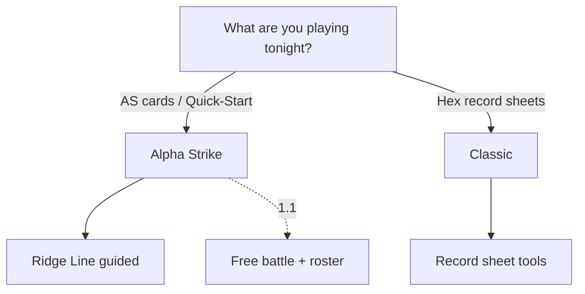

# TableMech — game mode product scope

**Last updated:** 2026-08-21

| Mode | ID | Engine | Rules basis | Release intent |
|------|-----|--------|-------------|----------------|
| **Alpha Strike** | `alpha-strike` | `alphaStrikePhased` | Free Quick-Start + box cards | **1.0 MVP** |
| **Classic** | `classic-tw` | `classicTWPhased` | Total Warfare–style tools | Gated; tools before guided |

## Player routing

## Explicitly out of v1

- Full Alpha Strike Companion / tournament rules beyond Quick-Start scope
- Networked multiplayer / shared match sync
- Official MUL bulk redistribution
- Classic full campaign / BV list building

## Related

- [ScreenCatalog](../../specs/screens/ScreenCatalog.md)
- [ClassicModeSpec](../../specs/features/ClassicModeSpec.md)
- [ReleaseSurfaceSpec](../../specs/ReleaseSurfaceSpec.md)
